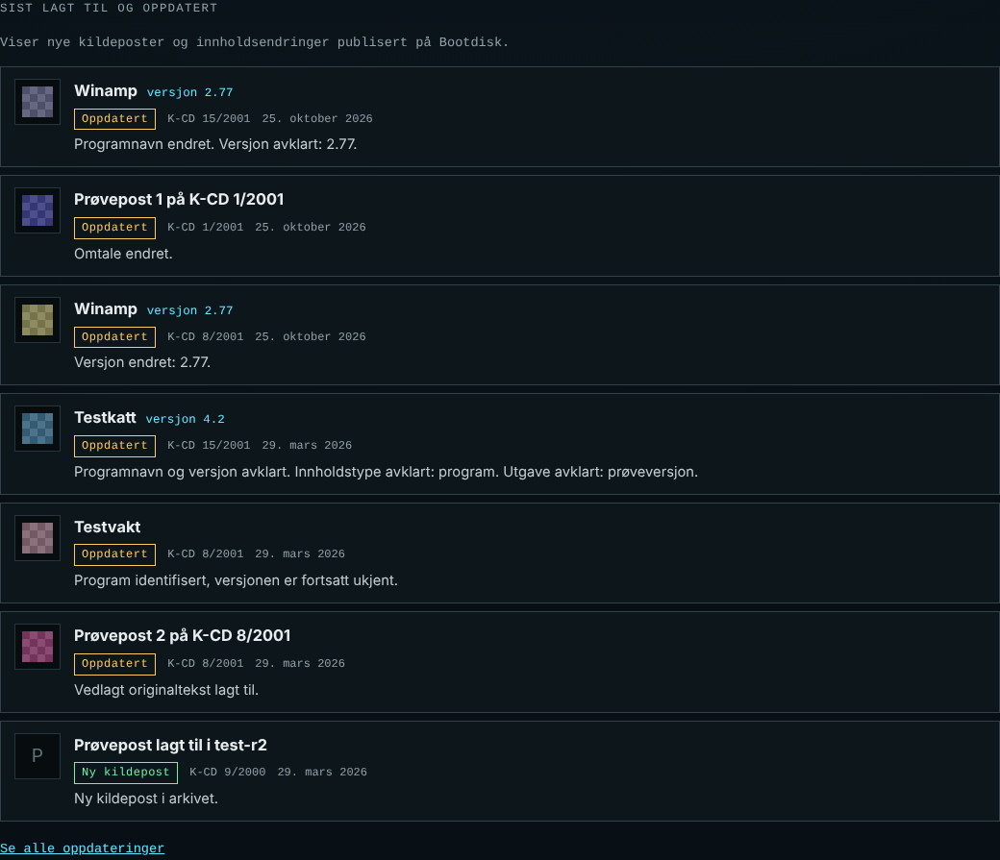
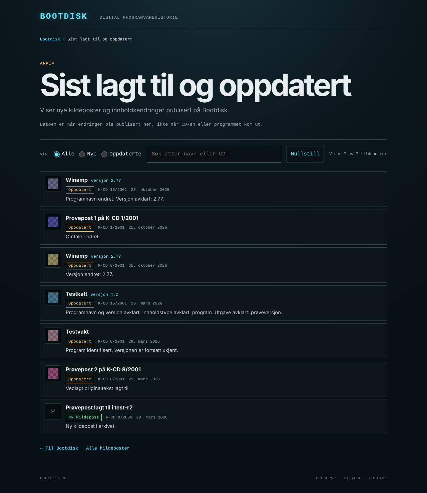
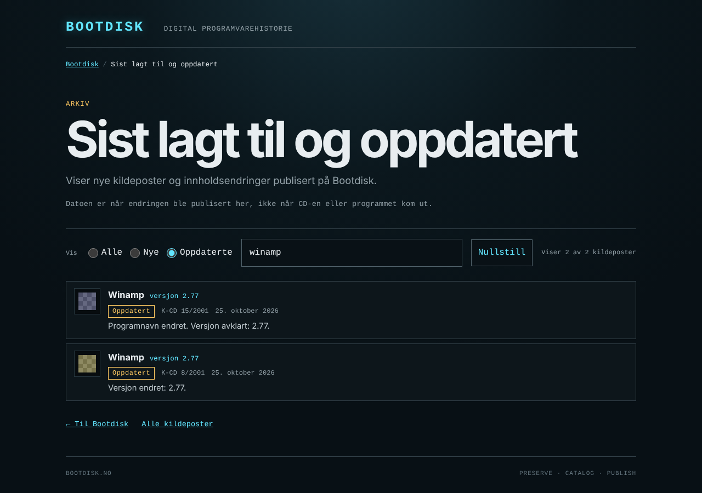
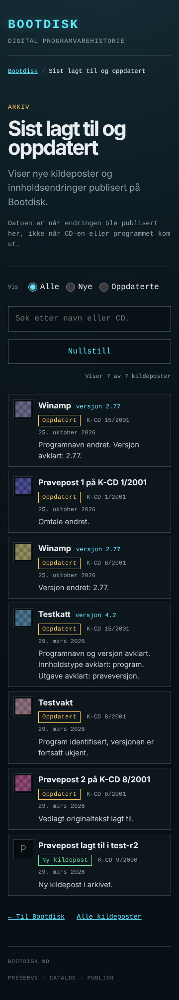
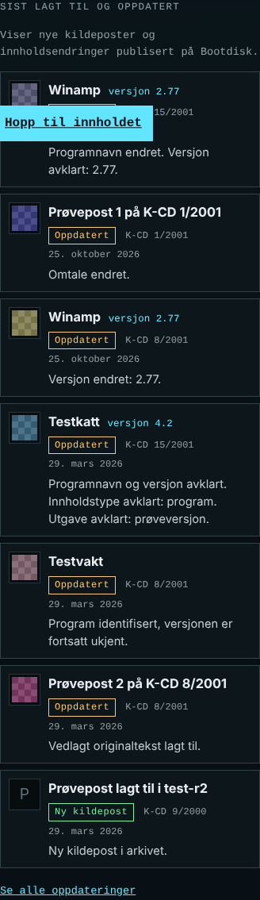

# Sist lagt til og oppdatert

Besøkende kan se hvilke kildeposter som er nye i arkivet, og hvilke eksisterende poster som
har fått en innholdsendring de kan se. Forsiden har en kort seksjon med de åtte nyeste, og
`updates.html` viser hele oversikten med filter, søk og «Vis flere».



Alle skjermbildene i `docs/public-updates/` er tatt av en pakket release med **testdata**
(`tests/synthetic_updates.py`). Navn som «Testkatt», «Testvakt» og «Prøvepost», datoene og
antallene er oppdiktet og sier ingenting om det ekte arkivet.

## Hva leseren ser

- **Forsiden**, under samlingene: «Sist lagt til og oppdatert», forklaringen «Viser nye
  kildeposter og innholdsendringer publisert på Bootdisk.», de åtte nyeste radene og lenken
  «Se alle oppdateringer».
- **`updates.html`**: samme rader for alle poster, filter «Alle / Nye / Oppdaterte», søk
  etter navn eller CD og «Vis flere» i porsjoner på 25. Søk og filter gjelder hele
  datasettet. Et nytt filter eller søk starter på første porsjon. Når «Vis flere» brukes,
  flyttes fokus til første nye rad.
- **Hver rad** er én kildepost og lenker til postens vanlige detaljadresse
  (`index.html?entry=…`). Raden viser programnavnet (eller CD-menyens tittel for uavklarte
  poster), versjon når den er kjent, CD-en, datoen og merket «Ny kildepost» eller
  «Oppdatert», og en kort forklaring som «Programnavn og versjon avklart.», «Program
  identifisert, versjonen er fortsatt ukjent.», «Versjonen er ikke lenger oppgitt.» eller
  «Vedlagt originaltekst lagt til.». Ikon eller skjermbilde fra indeksen vises når det
  finnes; ellers vises forbokstaven i en dempet rute. Entry-ID-er, K-koder og hasher vises
  aldri som navn.
- **Datoen** er når endringen ble publisert på Bootdisk, vist på norsk i Europe/Oslo
  («25. oktober 2026»). Siden sier det rett under overskriften.
- **Adressen** bærer filteret og søket (`updates.html?type=updated&q=winamp`), som arkivet:
  lenken kan deles, og tilbakeknappen fra en detaljside gir samme utvalg.




Mobil (360 px):




### Tilstander

| Tilstand | `updates.html` | Forsiden |
|---|---|---|
| Laster | «Laster oppdateringene…» | Seksjonen er skjult til data er lest |
| Ingen historikk publisert (`data/public-updates.json` svarer 404, eldre pakker) | «Endringsoversikten er ikke publisert ennå. Arkivet og alle kildeposter er tilgjengelige som før.» | Seksjonen vises ikke |
| Tom historikk (gyldig feed, ingen rader) | «Ingen nye eller oppdaterte kildeposter er registrert ennå.» | Samme tekst i seksjonen, uten «Se alle» |
| Tomt søkeresultat | «Ingen oppdateringer passer med søket eller filteret.» Filtrene står igjen | – |
| Feil (HTTP-feil, ugyldig JSON, ukjent skjema eller kode) | «Endringsoversikten kunne ikke lastes akkurat nå. Det betyr ikke at arkivet er tomt. …» | «Oppdateringene kunne ikke lastes akkurat nå. Samlingene og arkivet er ikke berørt.» |

Seksjonen på forsiden lastes av et eget script. En feil der rører ikke samlingene,
arkivet eller detaljsidene.

## Datakontrakt `bootdisk-public-updates-v2`

Historikken er et lite JSON-register. Det publiseres byte for byte som
`data/public-updates.json` i releasepakken, ved siden av indeksen. Navnet kan ikke kollidere
med et detaljdokument, fordi entry-ID-er krever `--` foran bindestrek.

```json
{
 "schema": "bootdisk-public-updates-v2",
 "projection": "visible-v2",
 "baseline": {"release_id": "1.2.0-rc11", "projection_sha256": "…", "entries": ["K13", "…"]},
 "releases": [{"release_id": "1.2.0-rc12", "previous_release_id": "1.2.0-rc11",
               "published_at": "2026-10-15T…Z", "projection_sha256": "…", "added": 0, "updated": 88}],
 "events": [{"release_id": "1.2.0-rc12", "published_at": "2026-10-15T…Z", "entry": "kcd-15-2001--K3",
             "medium_id": "kcd-15-2001", "source_entry": "K3", "type": "updated",
             "changes": ["identified", "name_added", "version_added"]}]
}
```

(Verdiene over er bare eksempel på formen.)

- `baseline`: den første publiserte utgaven historikken bygger på. Postene står oppført uten
  dato og får ingen hendelse.
- `releases`: én rad per registrert publisering, i rekkefølge, med `previous_release_id`
  som kjede tilbake til grunnlaget. `published_at` er eksplisitt UTC (`…Z`) og strengt
  stigende. `projection_sha256` er fingeravtrykket av den synlige projeksjonen (under) for
  utgaven; `added`/`updated` er antall hendelser.
- `events`: hendelser sortert etter utgave og entry-ID. `entry` er den permanente offentlige
  ID-en. `medium_id` og `source_entry` er bindingen til kilden (null for en 1.0-indeks uten
  dem). `type` er `added` eller `updated`; `changes` er kontrollerte koder i fast rekkefølge,
  tom for `added`.

Ingen andre felt er tillatt. Registeret har ingen lokale stier, arbeidslogger, kladder,
kvitteringer eller kurateringsdata.

### «Ny» og «Oppdatert»

- **`added`**: entry-ID-en manglet i forrige publiserte projeksjon og finnes i den nye.
  Første gang en eksisterende post identifiseres er `updated`, ikke `added`.
- **`updated`**: den synlige projeksjonen av samme entry-ID er endret.
- En post som er borte fra kandidaten får ingen hendelse; dens eldre hendelser blir stående,
  men vises ikke, så ingen rad lenker til en post som ikke finnes.
- En entry-ID som har byttet `medium_id` eller `source_entry` avvises i stedet for å bli
  rapportert som oppdatert. En K-kode alene er ikke unik.

### Feltene som sammenlignes (`visible-v2`)

Definert i `visible_projection` i `scripts/public_updates.py`, som speiler det `app.js` og
arkivkortet faktisk viser:

| Felt | Kilde | Koder |
|---|---|---|
| Identifiseringsstatus | `curation_status`, og `software[0].status == "interpreted"` | `identified`, `identification_confirmed`, `interpreted`, `identification_withdrawn` |
| Programnavn | `software[0].software_name` | `name_added`, `name_changed`, `name_removed` |
| Versjon | `software[0].version`; `null`, tom og `unknown` er ukjent | `version_added`, `version_changed`, `version_removed` |
| Innholdstype | `software[0].content_kind`, bare verdier detaljsiden har navn for | `content_kind_added/changed/removed` |
| Utgave | `software[0].distribution_kind` (`full`, `demo`, `trial`, `update`) | `distribution_kind_added/changed/removed` |
| CD-menyens tittel | `editorial_title` | `menu_title_changed` |
| Vist omtale | `source_context.description.value`, ellers kuratert `nb-NO`-beskrivelse; og hvilken av dem | `description_added/changed/removed` |
| Ikon og skjermbilde | SHA-256 av originalen til første `icon` og første `screenshot` | `icon_*`, `screenshot_*` |
| Vedlagte originaltekster | Bare dokumenter bundet til postens egen kilde: SHA-256, lesbar tekst og CD-filnavnet som vises | `source_document_added/changed/removed` |
| Merknad om kildeavvik | Hvilke merknader detaljsiden viser ut fra `source_context.issues` (under) | `source_issues_added`, `source_issues_changed`, `source_issues_removed` |

Sammenlignes ikke, og gir derfor aldri en hendelse alene: JSON-formatering og
nøkkelrekkefølge, `public_path` og andre lagringsstier, derivater (miniatyrer), manifest-
digest, Catalogs `release_id`/`software_id`/`description_id`, `source_order`, tekniske
proveniensfelt som `source_ref`, `pointer` og `observation_manifest`, mappe- og
filtider, byggetid, nettsidens versjon og CSS/JavaScript. CD- og publikasjonsnavn hører
til samlingen og regnes ikke som innholdsendring i posten.

Et felt som går fra kjent til ukjent er en reell oppdatering. Forklaringen sier da at
verdien «ikke lenger er oppgitt», aldri «avklart». Generatoren endrer aldri omtaler, navn,
versjon eller utgave; den sammenligner bare.

Endres listen over felt, skal `projection` og kontraktnavnet få ny versjon. Ellers ville
fingeravtrykkene skifte uten at innholdet har endret seg.

#### Merknader om kildeavvik

De rå avvikskodene vises ikke. Detaljsiden (`app.js`) gjør dem om til høyst to merknader,
og projeksjonen lagrer de merknadene, sortert i fast rekkefølge (`source_notes`):

| Merknad i projeksjonen | Når | Tekst på detaljsiden |
|---|---|---|
| `untested_shared_control` | `shared_warning_control_not_runtime_tested` finnes | «Programfilen finnes på CD-en. Den gamle installasjonsmenyen har overlappende knapper …» |
| `unresolved_file_references` | En hvilken som helst annen kode finnes | «CD-menyen har motstridende eller manglende filhenvisninger …» |

- Ingen merknad → merknad: `source_issues_added` («Kildeavvik merket.»).
- Merknad → ingen merknad: `source_issues_removed` («Kildeavvik ikke lenger merket.»).
- Én merknadsmengde → en annen, begge ikke-tomme: `source_issues_changed` («Merknaden om
  kildeavvik er endret.»). Det gjelder både spesiell → generell og spesiell → spesiell +
  generell.
- To rå koder som gir samme viste merknad (for eksempel `missing_launch_file` byttet med en
  annen generell kode, eller en generell kode til) gir ingen hendelse.

Når `app.js` endrer hvilke merknader som vises, må `visible_projection` følge med, og
projeksjonen få ny versjon.

#### Versjoner

- `visible-v1` / `bootdisk-public-updates-v1` (første utkast av denne grenen, aldri
  publisert) projiserte kildeavvik som én sann/usann-verdi. Etter rc13 viser detaljsiden to
  ulike merknader, og et bytte mellom dem ga ingen hendelse.
- `visible-v2` / `bootdisk-public-updates-v2` projiserer de viste merknadene og legger til
  `source_issues_changed`. Nettsiden godtar bare v2. Et v1-register kan ikke oppgraderes
  (fingeravtrykkene er annerledes); det registreres på nytt fra de publiserte pakkene med
  de samme tidspunktene.

## Verktøyet: `scripts/public_updates.py`

```sh
# Vis hva en publisering ville gitt. Skriver ingenting.
python3 scripts/public_updates.py preview FORRIGE/data KANDIDAT/data [--expect-added N] [--expect-updated N] [--expect-unchanged N] [--show ENTRY]

# Første gang: FORRIGE blir datoløst grunnlag, og KANDIDAT registreres i samme steg.
python3 scripts/public_updates.py record FORRIGE/data KANDIDAT/data --baseline-release-id ID_FORRIGE \
  --release-id ID_KANDIDAT --published-at 2026-10-15T09:30:00Z --output NY/public-updates.json

# Senere: registeret fra forrige publiserte pakke føres videre.
python3 scripts/public_updates.py record FORRIGE/data KANDIDAT/data --register FORRIGE/data/public-updates.json \
  --release-id ID_KANDIDAT --published-at TIDSPUNKT --output NY/public-updates.json

python3 scripts/public_updates.py validate REGISTER [--frontend-data DATA]
python3 scripts/public_updates.py init PUBLISERT/data --release-id ID --output NY/public-updates.json
```

Regler:

- **Ingen skjult klokke.** `--published-at` er påkrevd og må være UTC med `Z`. Tidspunktet
  skal være den faktiske publiseringstiden fra publiseringsprosessen, ikke byggetiden.
- **Grunnlag uten dato.** `init` og `--baseline-release-id` registrerer de eksisterende
  postene uten dato og uten hendelser. Ingen post blir «ny i dag» fordi historikken innføres.
- **Videreføring.** `record` krever at FORRIGE er den sist registrerte tilstanden
  (fingeravtrykket må stemme), og at tidspunktet er senere enn forrige utgave. Registeret
  skrives til en ny fil; en eksisterende fil overskrives ikke. En publisert pakke inneholder
  sitt register i `data/public-updates.json`, så neste utgave kan bruke pakken som FORRIGE
  og registeret som `--register`.
- **Idempotens.** Samme utgave med samme innhold og samme tidspunkt gir byte-likt register
  uten nye hendelser. Samme release-ID med annet tidspunkt eller annet innhold avvises med
  «already registered …».
- **Forhåndsvisning.** `preview` og et vanlig `build-release.py` uten `--updates` skriver ingen
  historikk og stempler ingenting som publisert.
- **Releasebygget** (`build-release.py --updates REGISTER`, også gjennom
  `build-release-artifact.py`) validerer registeret mot indeksen og krever at registerets
  nyeste tilstand har samme fingeravtrykk som dataene som pakkes. Et eksplisitt oppgitt,
  ugyldig eller utdatert register stopper bygget. Uten `--updates` bygges pakken som før,
  uten feed, og `updates.html` står ikke i sitemap.
- **Web-utgivelse uten dataendring** kan sende med samme register uendret.

## Integrasjon

| Fil | Endring |
|---|---|
| `updates.html`, `updates.js`, `updates-core.js`, `updates.css` | Ny side. `updates-core.js` har reglene uten DOM-tilgang, testet i Node. |
| `index.html`, `landing-updates.js` | Ny seksjon under samlingene, eget script. |
| `scripts/public_updates.py` | Kontrakt, projeksjon, differanse, register og CLI. |
| `scripts/build-release.py` | `--updates`; nye statiske filer i den eksplisitte fillisten; `updates.html` i sitemap når feed følger med. |
| `scripts/build-release-artifact.py` | `--updates`; rapporten får `updates` med release-ID-er, tidspunkt, antall og SHA-256. |
| `scripts/frontend_contract.py` | `public-updates.json` godtas ved siden av projeksjonen; `--updates` validerer registeret mot dataene. |
| `scripts/verify-deployment.py` | Krever `updates.html` med canonical; validerer en publisert feed mot indeks og detaljdokumenter; `updates.html` i sitemap bare med feed; `--require-updates`; `scripts/public_updates.py` og testdata skal svare 404. |

JSON lastes med `cache: "no-cache"` som i rc11. Nye scripts har `?v=updates1`; `updates-core.js` har `?v=updates2` etter kontrakt v2. Ingen
service worker. Siden laster bare `data/index.json` og `data/public-updates.json`, aldri
ett dokument per post.

## Kontrollmatrise

Testene ligger i `tests/test_public_updates.py` (generator, register, releasebygg,
HTTP-verifikator og sidelogikk i Node) og `tests/test_public_updates_browser.py` (Chromium
mot pakkede releaser). Alle bruker testdataene i `tests/synthetic_updates.py`.

Kjøringer av hele pakken (`python -m unittest discover -s tests`):

| Kjøring | Funnet | Bestått | Feilet | Hoppet over |
|---|---:|---:|---:|---:|
| Main `0a4ef07` før endringen, Chromium og Node | 268 | 267 | 0 | 1 |
| Denne grenen (v2), Chromium og Node 22 | 317 | 316 | 0 | 1 |
| Denne grenen (v2) uten Playwright, som i CI | 317 | 216 | 0 | 101 |

Den ene hoppede testen i begge Chromium-kjøringene krever en `bootdisk-catalog`-checkout
(`BOOTDISK_CATALOG_ROOT`), som ikke finnes i dette miljøet. Av de 49 nye testene kjører 37
uten nettleser og 12 i Chromium. En hoppet nettlesertest er ikke en bestått nettlesertest.

| # | Scenario | Forventet | Test | Resultat |
|---|---|---|---|---|
| 1 | Ny offentlig post | Én «Ny kildepost», lenke til eksisterende detaljside | `test_new_entry_is_added_and_others_are_never_new`, `test_rows_link_to_the_existing_detail_pages` | Bestått |
| 2 | Ventende → identifisert | «Oppdatert», ikke «Ny»; ukjent versjon forblir ukjent | `test_pending_to_identified_keeps_unknown_version_unknown`, `test_explanations_are_concrete_and_honest`, `test_rows_show_name_cd_date_badge_and_explanation` | Bestått |
| 3 | Kjent → ukjent versjon, korrigert navn | `name_changed`, `version_removed`; «Programnavn endret. Versjonen er ikke lenger oppgitt.», aldri «avklart» | `test_known_to_unknown_is_a_removal_not_a_clarification`, `test_explanations_are_concrete_and_honest` | Bestått |
| 4 | Omtale, bilde, vedlagt originaltekst; ny lagringssti | Riktig kode; flyttet sti gir ingen hendelse | `test_r2_and_r3_give_exactly_the_expected_events`, `test_each_visible_field_has_its_code`, `test_storage_path_and_derivatives_are_not_content`, `test_technical_changes_alone_give_no_event` | Bestått |
| 5 | Uendret ombygging, omformatert JSON, ny manifestdigest, ny release med likt innhold | Ingen hendelser | `test_unchanged_rebuild_and_identical_new_release_give_zero_events`, `test_technical_changes_alone_give_no_event` | Bestått |
| 6 | Samme release to ganger; motstridende gjenbruk | Byte-likt register; tydelig feil | `test_same_release_twice_is_idempotent`, `test_conflicting_reuse_of_a_release_id_is_refused`, `test_record_with_baseline_in_one_step_matches_init_then_record` | Bestått |
| 7 | Flere hendelser for én post; samme program på to CD-er | Én rad med siste hendelse; to rader | `test_one_row_per_entry_with_its_latest_event_and_no_removed_entries` | Bestått |
| 8 | Likt tidspunkt; UTC rundt midnatt og sommertid | Stabil rekkefølge på entry-ID; riktig norsk dato | `test_one_row_per_entry_…` (omvendt hendelsesrekkefølge gir samme resultat), `test_dates_are_norwegian_in_oslo_around_midnight_and_summer_time`, `test_rows_show_name_cd_date_badge_and_explanation` | Bestått |
| 9 | Første grunnlag | Ingen datoer, ingen hendelser, tom-tilstand | `test_first_baseline_has_no_dates_and_no_new_entries`, `test_missing_empty_and_failing_history_are_distinct_…` (`empty`) | Bestått |
| 10 | Fjernet post; filtre med søk og «Vis flere» | Ingen død lenke; filtre virker sammen | `test_removed_entry_is_not_listed`, `test_filters_search_address_and_back_button`, `test_filters_and_search_cover_the_whole_dataset`, `test_five_thousand_rows_…` | Bestått |
| 11 | Manglende, ugyldig, feilende data; tom feed; tomt søk | Egne tilstander; forside, samling og arkiv virker | `test_missing_empty_and_failing_history_are_distinct_and_leave_the_site_working` (5 tilfeller × side, forside og arkiv), `test_no_match_is_its_own_state`, `test_feed_validation_and_loading_states` | Bestått |
| 12 | Tastatur og mobil | Fokus synlig, piltaster i filteret, Enter åpner posten, ingen horisontal rulling ved 320/360 px, trykkflater ≥ 44 px | `test_keyboard_reaches_filters_search_and_rows_with_visible_focus`, `test_narrow_screens_have_no_horizontal_scroll_and_readable_dates`, `test_source_text_is_never_html` | Bestått i Chromium |
| 13 | Ekte rc11 → rc12 → rc13 | rc12: 0 nye, 88 oppdaterte, 281 uten hendelse; rc13: 3 nye, 0 oppdaterte, 369 uten hendelse | Kjørt av Birk på `695071e` (v1) med tidspunkter fra kvitteringene; `verify-deployment.py --require-updates` bestått for begge pakkene; SuperCat, Ad-aware og «Nye» på rc13 (Toonworks, PicturesToExe, WindowBlinds) riktig i nettleser. Må kjøres på nytt med v2 (kommando under) | Bestått på v1; v2 gjenstår |
| 14 | 5 000 poster (testdata) | Søk og paginering virker; bare indeks og feed lastes | `test_five_thousand_rows_page_in_portions_of_25_without_per_entry_requests`, `test_five_thousand_rows_filter_quickly` | Bestått; se tider i PR |
| 15 | Ferdig pakke | Side og feed med, sitemap/canonical riktig, ingen kuratering; ugyldig register stopper bygget; HTTP-verifikator | `test_package_contains_page_feed_and_nothing_private`, `test_sitemap_and_canonical_include_the_updates_page_only_with_history`, `test_release_refuses_explicit_invalid_or_stale_history`, `test_http_verifier_checks_the_deployed_history`, `test_release_artifact_reports_the_history`, og hele den eksisterende pakken | Bestått på testdata |
| 16 | Endret merknad om kildeavvik | Spesiell → generell og spesiell → spesiell + generell gir én oppdatering (`source_issues_changed`); to generelle rå koder med samme merknad gir ingen; ingen ↔ merknad gir `added`/`removed`; koden godtas av generator, register og nettside og forklares på norsk | `test_source_issue_events_follow_the_notes_the_detail_page_shows`, `test_changed_source_note_is_one_update_event_in_the_register`, `test_explanations_are_concrete_and_honest`, `test_feed_validation_and_loading_states`, `test_codes_match_the_python_contract` | Bestått |

Registeret avviser også ødelagt historikk (12 tilfeller i
`test_register_validation_rejects_broken_history`): feil skjema, dupliserte hendelser, ukjente
koder og typer, lokal tid, feil antall, brutt kjede, feil rekkefølge, ukjente felt og tid
som går bakover.

### Endringer i eksisterende tester

- `test_front_and_collection_pages_read_only_the_index_and_registry` krever nå at forsiden
  også henter `data/public-updates.json` (én kompakt fil; ingen detaljdokumenter).
  Samlingssiden er uendret. Testen feilet på grenen før endringen, som forventet.
- `test_public_pages_show_the_counter_and_private_or_error_pages_do_not` omfatter
  `updates.html`.
- `test_all_public_loaders_revalidate` kontrollerer også de to nye lasterne.

Ingen kontroller er fjernet eller svekket.

## Ekte akseptanse rc11 → rc12 → rc13

Birk kjørte stegene under på `695071e` (kontrakt v1) med de faktiske publiseringstidspunktene
fra kvitteringene: rc12 ga 0 nye, 88 oppdaterte og 281 uten hendelse, rc13 ga 3 nye, 0
oppdaterte og 369 uten hendelse, og HTTP-verifikatoren besto for begge pakkene. De lokale
registrene derfra er v1 og avvises av v2-nettsiden og -bygget. De registreres på nytt med de
samme kommandoene og tidspunktene. Tallene er ikke kontrollert med v2: endres de, er
forskjellen et bytte mellom viste kildeavviksmerknader som v1 ikke så, og `preview` viser
kodene.

Kjøres i en egen worktree. Kildemappene leses bare; alt skrives under `/tmp`. Port 8805.

```sh
git -C /Users/stian/Bootdisk/bootdisk-web fetch origin feat/recent-source-posts
git -C /Users/stian/Bootdisk/bootdisk-web worktree add /Users/stian/Bootdisk/bootdisk-web-updates origin/feat/recent-source-posts
cd /Users/stian/Bootdisk/bootdisk-web-updates
R=/Users/stian/Bootdisk/local-results/releases
RC11="$R/bootdisk-web-1.2.0-rc11"
RC12="$R/bootdisk-web-1.2.0-rc12"
OUT=/tmp/bootdisk-updates-rc12
mkdir -p "$OUT"

# 1. Finn ID-ene for SuperCat og Ad-aware i rc12-indeksen.
python3 -c 'import json,sys; [print(e["entry"], e.get("software_name"), e.get("version"), e.get("medium")) for e in json.load(open(sys.argv[1]))["entries"] if (e.get("software_name") or "").lower().startswith(("supercat","ad-aware"))]' "$RC12/data/index.json"

# 2. Forhåndsvis: skal gi 0 nye, 88 oppdaterte og 281 uten hendelse. Skriver ingenting.
python3 scripts/public_updates.py preview "$RC11/data" "$RC12/data" \
  --expect-added 0 --expect-updated 88 --expect-unchanged 281 --show SUPERCAT_ID --show ADAWARE_ID

# 3. Les publiseringstiden for rc12 i kvitteringen og skriv den som UTC med Z.
#    Kopier bare tidspunktet; resten av kvitteringen skal ikke inn i offentlige data.
PUBLISHED_AT=…   # fra /Users/stian/Bootdisk/local-results/curation-publish-2026-10-15/publication-receipt.json

# 4. Registrer rc11 som grunnlag og rc12 med det faktiske tidspunktet.
python3 scripts/public_updates.py record "$RC11/data" "$RC12/data" --baseline-release-id 1.2.0-rc11 \
  --release-id 1.2.0-rc12 --published-at "$PUBLISHED_AT" --output "$OUT/public-updates.json" \
  --expect-added 0 --expect-updated 88 --expect-unchanged 281

# 5. Bygg en lokal pakke med rc12-dataene og registeret, og kontroller den over HTTP.
python3 scripts/build-release.py "$RC12/data" "$RC12" --output "$OUT/site" --expected-entries 369 \
  --updates "$OUT/public-updates.json"
python3 -m http.server --bind 127.0.0.1 --directory "$OUT/site" 8805
```

I en annen terminal:

```sh
python3 scripts/verify-deployment.py http://127.0.0.1:8805/ --expected-entries 369 --require-updates
```

Åpne <http://127.0.0.1:8805/updates.html> og kontroller at:

- telleren viser 88 kildeposter, «Nye» gir tomt søkeresultat og «Oppdaterte» 88;
- SuperCat på K-CD 15/2001 viser versjon 4.2 og en forklaring med «Programnavn og versjon
  avklart» og «Utgave avklart: prøveversjon» (forutsatt at rc12-dataene har
  `distribution_kind: "trial"`);
- Ad-aware på K-CD 8/2001 viser «Program identifisert, versjonen er fortsatt ukjent.»;
- datoen er rc12-publiseringsdatoen fra kvitteringen i norsk tid;
- en rad åpner riktig detaljside, og forsiden viser de åtte første.

Merknader:

- `qualification.json` brukes ikke av verktøyet. Tallene 88/0/281 kontrolleres mot det
  verktøyet faktisk finner i rc11- og rc12-dataene.
- `--expect-unchanged 281` teller poster uten synlig endring. Hvis den feiler mens 88 og 0
  stemmer, er noen av de 281 byte-ulike rc11/rc12-filene endret på en måte projeksjonen
  ser. `preview` viser kodetellingen.
- De 23 teknisk uavklarte i den siste runden er blant de 281. Tallet gjelder bare den
  runden, ikke alle uavklarte poster i arkivet.
- rc12 og rc13 er allerede publisert uten feed. Registeret fra steg 4 beskriver rc12-dataene
  og kan ikke sendes med en pakke bygget fra rc13-dataene (bygget avviser det). Før en
  pakke fra rc13-dataene får historikk, må rc13 registreres i samme kjede med sitt faktiske
  publiseringstidspunkt. Med release-notatet for rc13 forventes 3 nye kildeposter og 0
  oppdaterte, men det er ikke kontrollert her:

  ```sh
  RC13=…   # rc13-pakkens mappe (med data/ og store/)
  python3 scripts/public_updates.py record "$RC12/data" "$RC13/data" --register "$OUT/public-updates.json" \
    --release-id 1.2.0-rc13 --published-at "$RC13_PUBLISHED_AT" --output "$OUT/public-updates-rc13.json" \
    --expect-added 3 --expect-updated 0
  python3 scripts/build-release.py "$RC13/data" "$RC13" --output "$OUT/site-rc13" --expected-entries 372 \
    --updates "$OUT/public-updates-rc13.json"
  ```

  Birk avgjør pakken og kvalifiseringen.

## Lokal forhåndsvisning med testdata

```sh
python3 tests/synthetic_updates.py /tmp/bootdisk-updates-preview
python3 -m http.server --bind 127.0.0.1 --directory /tmp/bootdisk-updates-preview 8806
```

Åpne <http://127.0.0.1:8806/updates.html>. Pakken er bygget av den vanlige releasebyggeren
med testhistorikk (`test-r1` til `test-r3`). Den skal aldri publiseres.

## Begrensninger

- Ekte akseptanse (rad 13) er kjørt på v1; v2-registrene må lages på nytt fra pakkene.
- Forklaringen bruker gjeldende verdier fra indeksen (versjon, utgave, innholdstype). De er
  riktige for postens siste hendelse fordi bygget krever at registeret beskriver dataene,
  men eldre hendelser for samme post vises ikke.
- Indeksen må ha `content_kind` og `distribution_kind` for at forklaringen skal ta med
  verdien («Utgave avklart: prøveversjon»). Uten dem vises bare «Utgave avklart».
- Antall viste rader (`Vis flere`) står ikke i adressen; tilbakeknappen gir første porsjon
  med samme filter og søk.
- Ingen RSS, varsling, slettemeldinger, full differansevisning eller aktivitetsstrøm.
